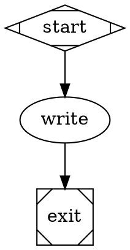

# Petri

A Rust workflow engine for running CI and AI agent workflows, embedded in your application or from the command line.

[](https://github.com/lithoscomputer/petri/actions/workflows/ci.yml)
[](#license)

```sh
cargo install --locked --git https://github.com/lithoscomputer/petri --branch main petri-cli
cargo install --locked --git https://github.com/lithoscomputer/sandbox-driver --rev 691cb4e5b8425434c1fe24becc47962a4fae9ce4 sandbox-driver-host
```

Save this as `hello.yml`:

```yaml
name: hello
nodes:
  greet:
    run: echo "Hello from Petri"
    next: done
  done:
    run: echo "Workflow complete"
```

```sh
petri run hello.yml --run-dir petri-run --sandbox-plugin-dev
petri inspect --run-dir petri-run
```

```text
run: success
root: invocation 0 final execution 0
invocation 0: finished graph 072728911e6b5b37d5194d366e02d426f5140f071e4f1438776314c8d242dd4c executions [0]
execution 0 (invocation 0, index 0): finished log 16 records replay verified
  success greet gen 0 attempt 1
  success done gen 0 attempt 1
```

Part of [Lithos](#part-of-lithos), a family of Rust building blocks for AI tools.

Petri runs every command through a sandbox plugin, a separate executable.
The host plugin runs commands on your machine.
`--sandbox-plugin-dev` lets a source-built binary launch the plugin you installed; see [Install](#install).
`petri inspect` replays the run's event log and checks that replay produces the same records.

## Why does this exist?

CI jobs and agent workflows need branching, parallel work, retries, and cancellation.
Existing tools cover one side each: [act](https://github.com/nektos/act) runs GitHub Actions locally, [Temporal](https://temporal.io/) runs durable service workflows, and [LangGraph](https://github.com/langchain-ai/langgraph) builds agent graphs.
Petri runs both kinds of workflow through one engine, with explicit routing and a replayable event log.
Applications can embed the runtime and supply their own storage, controls, and user interface.

## Who is it for?

**Use it if** you are building a workflow runner or an AI tool that combines commands, agents, and human decisions.
It also runs supported GitHub Actions workflows locally.

**Look elsewhere if** you need a hosted CI service with triggers, runner scheduling, and a web interface.
Use GitHub Actions for workflows that require GitHub's hosted environment or unsupported runner features.
If you only need to run GitHub Actions locally, act may fit better.

## What does it do?

- Runs native YAML workflows with explicit branches, joins, loops, and parallel work.
- Runs supported GitHub Actions jobs, actions, matrices, and reusable workflows.
- Runs [Attractor](https://github.com/lithoscomputer/petri/blob/main/crates/attractor/FORMAT.md) agent workflows written as Graphviz DOT graphs.
- Reads the settings of [Fabro](https://fabro.sh), a tool that runs AI coding agents through workflow graphs, including models, environments, and hooks.
- Executes commands on the host, in Docker, or in [Daytona](https://www.daytona.io/) cloud sandboxes through provider plugins.
- Records runs for inspection, replay, and recovery after a process exits unexpectedly.
- Exposes events, human questions, secrets, and lifecycle hooks to an embedding application.

**Out of scope:** a hosted control plane, UI, trigger service, and cross-run scheduling.
The application supplies those, along with credentials and any custom storage or policy.
GitHub Actions compatibility is a supported subset; see the [support matrix](https://github.com/lithoscomputer/petri/blob/main/crates/github/SUPPORT.md).

### How it works

A frontend compiles each workflow file into a graph. Each format has its own frontend.
Nodes are steps. Tokens move along the edges, and each node states where its tokens go next.
The engine runs each step in a sandbox and appends every event to the run's log.
Inspection, replay, and resume all read that log.
The [architecture guide](https://github.com/lithoscomputer/petri/blob/main/docs/architecture.md) maps the full workspace.

| Crate | Use it when |
|---|---|
| `petri` | You want every shipped workflow format through one dependency. Core APIs are re-exported here. |
| `petri-runtime` | You want the native runtime and will register other formats yourself. |
| `petri-frontend-gha` | You are assembling a runtime with GitHub Actions support. |
| `petri-frontend-attractor` | You want to compile the Attractor language without Fabro settings. |
| `petri-frontend-fabro` | You want Attractor workflows with Fabro's settings and launch rules. |

## How do I use it?

### Install

The commands at the top install the CLI and the host plugin.
They build from Petri's lockfile, and the plugin revision matches it.
Keep Cargo's binary directory on `PATH`.

Source-built binaries have no bundled plugin digests, so they need `--sandbox-plugin-dev` to launch plugins.
See the [CLI guide](https://github.com/lithoscomputer/petri/blob/main/docs/cli.md#source-installation) for the Docker and Daytona plugins.
Docker workflows also need a running Docker daemon.
Agent workflows read model credentials such as `ANTHROPIC_API_KEY` and `OPENAI_API_KEY`.

### Run a GitHub Actions workflow

From the root of a Git repository:

```sh
petri check .github/workflows/ci.yml
petri run .github/workflows/ci.yml --repo "$PWD" --run-dir ../petri-ci-run --sandbox-plugin-dev
```

`actions/checkout` copies your working tree, including uncommitted changes, into the run's workspace.
Keep the run directory outside the repository so the copy does not include it.
Read [Running workflows you did not write](#running-workflows-you-did-not-write) first.

### Run an agent workflow

Save this as `haiku.dot`:



```sh
export ANTHROPIC_API_KEY=...
petri run haiku.dot --run-dir haiku-run --sandbox-plugin-dev
```

The `write` node runs an agent, and the CLI prints its reply.
See [agent configuration](https://github.com/lithoscomputer/petri/blob/main/crates/attractor/FORMAT.md#native-pebble) for other models and backends.

### Use it as a library

Petri is not published to crates.io. Add it from Git:

```sh
cargo add petri --git https://github.com/lithoscomputer/petri --branch main
cargo add tokio --features macros,rt-multi-thread
```

Your project's `Cargo.lock` picks its own sandbox-driver commit, which can differ from Petri's.
Install the host plugin at the commit after `#` on the `sandbox-driver` source line in your `Cargo.lock`.
Reinstall it when `cargo update` moves that commit.

Run a workflow:

```rust,no_run
use petri::{RunOptions, frontend::native};

#[tokio::main]
async fn main() -> Result<(), Box<dyn std::error::Error>> {
    let workflow = r#"
name: hello
nodes:
  greet:
    run: echo "Hello from Petri"
"#;
    let loaded = native::load("hello.yml", workflow);
    let graph = loaded.graph.ok_or("invalid workflow")?;
    let runtime = petri::runtime().options(RunOptions::new("petri-run"));
    let report = runtime.run(graph).await?;
    println!("{}", report.status);
    Ok(())
}
```

Validate workflow text without starting a command or acquiring a sandbox:

```rust
use petri::{Runtime, frontend::{CompileInputs, NoFiles}};

fn main() -> Result<(), Box<dyn std::error::Error>> {
    let workflow = "name: hello\nnodes:\n  greet:\n    run: echo hello\n";
    let checked = Runtime::standard().check_source(
        "hello.yml", workflow, &NoFiles, Some("native"), &CompileInputs::new(),
    )?;
    for diagnostic in checked.diagnostics.iter() {
        eprintln!("{diagnostic}");
    }
    checked.graph.ok_or("invalid workflow")?;
    Ok(())
}
```

`Runtime::standard()` includes the native format. `petri::runtime()` also registers GitHub Actions and Fabro support.
For durable coordination, nested workflows, and resume, use the `petri::host` helpers described in the [embedding guide](https://github.com/lithoscomputer/petri/blob/main/docs/embedding.md).
Build the API documentation in your project with `cargo doc --open -p petri`.

- [Native workflow format](https://github.com/lithoscomputer/petri/blob/main/crates/core/frontend-native/FORMAT.md): routing, joins, retries, and loops.
- [Embedding guide](https://github.com/lithoscomputer/petri/blob/main/docs/embedding.md): events, hooks, questions, and storage.
- [CLI guide](https://github.com/lithoscomputer/petri/blob/main/docs/cli.md): backends, human questions, controls, resume, and retention.
- [Fabro integration contract](https://github.com/lithoscomputer/petri/blob/main/crates/fabro/HANDOFF.md): host responsibilities and compatibility.

## Running workflows you did not write

- The host plugin does not isolate commands. They run as your user, with your files and network.
- Use `--backend docker` or `--backend daytona` for workflows you have not read.
- GitHub Actions steps such as `actions/github-script` and `gh` use `GITHUB_TOKEN` or your `gh` login when present. A local run can comment, tag, or release, as the workflow says.
- Unset `GITHUB_TOKEN`, or use a fine-grained read-only token.
- Agent nodes run commands and edit files in their sandbox, with the model credentials you supply.

Report security issues as described in [SECURITY.md](https://github.com/lithoscomputer/petri/blob/main/SECURITY.md).

## Status and compatibility

- **Maturity:** pre-1.0. Breaking changes are possible in any update; pin a commit if you need stability.
- **Releases:** no tagged releases yet. Track `main`, and see the [commit history](https://github.com/lithoscomputer/petri/commits/main) for changes.
- **Rust:** declared minimum 1.89; routine CI uses 1.97.1.
- **Platforms:** routine CI runs on Ubuntu 24.04 and macOS 15. Docker tests are required on Linux.
- **Workflow compatibility:** [GitHub Actions support matrix](https://github.com/lithoscomputer/petri/blob/main/crates/github/SUPPORT.md) and [Fabro compatibility contract](https://github.com/lithoscomputer/petri/blob/main/crates/fabro/acceptance/CONTRACT.md).
- **Persisted contracts:** versioned run logs, [public events](https://github.com/lithoscomputer/petri/blob/main/crates/core/execution/EVENTS.md), and [inspection output](https://github.com/lithoscomputer/petri/blob/main/crates/core/execution/INSPECT.md). Incompatible log versions are rejected.

## Part of Lithos

| Crate | Role |
|---|---|
| [lithos-llm](https://github.com/lithoscomputer/lithos-llm) | Model access: one client and catalog across LLM providers |
| [pebble](https://github.com/lithoscomputer/pebble) | Agent loop, plus a coding agent and CLI built on it |
| [sandbox-driver](https://github.com/lithoscomputer/sandbox-driver) | Sandboxes (host, Docker, cloud VMs) behind one interface |
| **[petri](https://github.com/lithoscomputer/petri)** | **Workflow engine that runs CI and agent workflows on the crates above** |

## Getting help and contributing

Ask questions and report bugs in [GitHub Issues](https://github.com/lithoscomputer/petri/issues).
See [DEVELOPING.md](https://github.com/lithoscomputer/petri/blob/main/DEVELOPING.md) for setup and checks,
and the [test guide](https://github.com/lithoscomputer/petri/blob/main/docs/testing.md) for coverage and compatibility evidence.
The [engine specification](https://github.com/lithoscomputer/petri/blob/main/engine-spec.md) and
[frontend contract](https://github.com/lithoscomputer/petri/blob/main/frontend-handoff.md) define the design.

## License

Licensed under either of [Apache License, Version 2.0](https://github.com/lithoscomputer/petri/blob/main/LICENSE-APACHE)
or [MIT license](https://github.com/lithoscomputer/petri/blob/main/LICENSE-MIT), at your option.

Unless you explicitly state otherwise, any contribution you intentionally submit for inclusion in Petri shall be dual licensed as above, without any additional terms or conditions.
