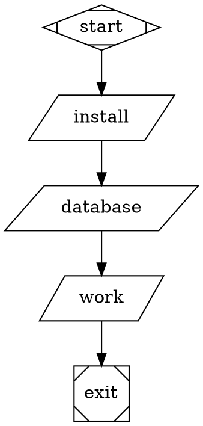

# Migrate preparation settings to workflow commands

`run.prepare` is no longer supported. Petri rejects its presence in
`workflow.toml`, `.fabro/project.toml`, and the host settings layer, even if
it is empty or overridden by another layer. Invalid TOML also fails admission.
Diagnostics identify the source and key without printing configuration values.
The legacy top-level `setup` key points to this same migration.

Put setup in ordinary command nodes after `start`, before the work that needs
it. For example, remove this section from `workflow.toml`:

```toml
[run.prepare]
timeout = "5m"
steps = [
  { command = ["bundle", "install"] },
  { script = "bundle exec rake db:prepare" },
]
```

If the original workflow was `start -> work -> exit`, replace it with:



## Preserve ordering, deadlines and failure policy

- Keep setup in the selected environment, after the existing checkout. Do not
  add another checkout or move setup to a host-side launch script.
- For a branching start, move **every** former outgoing start edge to the last
  setup node, retaining its conditions, labels, weights and other attributes.
  The edges connecting the setup sequence are unconditional.
- Preparation's default timeout was **five minutes per step**. Ordinary
  commands default to ten minutes. Set each setup node's `timeout` to the
  previous value, including `"5m"` when the old setting omitted it.
- Preparation specified `on_failure="exit"`; ordinary commands default to
  routing failures. Specify `on_failure="exit"` to stop downstream work.
- Generated setup nodes inherited graph `default_max_retries` (default zero)
  and graph `on_retries_exhausted` (otherwise the node's `on_failure`). Preserve
  those settings. Do not blanket-add `max_retries=0` to a graph that previously
  supplied another default. Ordinary shell exit failures are not
  `retry_requested` failures, so adding a retry count alone does not retry them.
- Preserve argv boundaries. For example, `["printf", "%s\\n", "a b; \"c\""]`
  becomes the shell script `printf '%s\n' 'a b; "c"'`, not an unquoted join.
  Put complex commands in a checked-in script and invoke it from a node.
  Continue to use the ordinary script renderer for input/variable templates;
  template interpolation is not shell command substitution.

Setup nodes receive the same visibility, events, hooks and failure handling as
other commands. Hooks can therefore run before dependencies have been installed;
review existing broad hook matchers if they assume setup has already completed.

## Environment variables and secrets

Use the existing workflow environment settings. For example:

```toml
[environments.local]
provider = "local"

[run.environment]
id = "local"

[run.environment.env]
FIRST_TOKEN = "{{ secrets.FIRST_TOKEN }}"
SECOND_TOKEN = "{{ secrets.SECOND_TOKEN }}"
```

These secrets remain references until process launch and retain output
redaction. They are available to **other workflow processes**, not just setup.
Moving a per-step secret here deliberately broadens its exposure. Do not claim
that the old per-step isolation is preserved.

Literal values can stay command-local: `MODE=first ./scripts/setup-one.sh`
and `MODE=second ./scripts/setup-two.sh`. If two steps previously used `TOKEN`
for different secrets, preserve that distinction with separate workflow keys
and quoted command-local mapping: `TOKEN="$FIRST_TOKEN" ./scripts/setup-one.sh`
and `TOKEN="$SECOND_TOKEN" ./scripts/setup-two.sh`. Both source keys still have
workflow-wide scope. Escape the double quotes when embedding those scripts in
DOT string attributes. Do not paste resolved secrets into scripts or logs.

There is no new per-node environment authoring feature. Server-wide setup must
move into each applicable workflow, or into a shared script explicitly invoked
by those workflows. Petri does not automatically rewrite configuration or graphs.

## Existing runs and library callers

New admission of old source fails with migration guidance. Historical source
and runs remain readable. Already-admitted graphs keep their ordinary command
nodes, names, encoded environment overlays and identifiers. Their stored graphs
are not regenerated from removed settings. Resume keeps completed commands
completed; a fresh execution of a saved graph executes its commands normally.
Fabro's retry/fork integration must retain the saved admission and its existing
restart/checkpoint behavior.

The `run_prepare_` prefix is ordinary authoring space now. The previous
name-based hook exemption is removed, including for commands in saved graphs
and previously user-authored nodes with that prefix. When those commands execute
under the new runtime, configured ordinary hooks can run. This does not replay
hooks for commands that already completed. Other synthetic-node hook rules stay
unchanged. The existing local hook service initializes configuration when
`start` runs; a cold resume or fork that skips `start` may not reload that
configuration. This removal does not change that initialization behavior.

Rust consumers must remove uses of `RunSettings.prepare`,
`RunSettings.prepare_timeout_ms`, `PrepareStep`, and `PREPARE_NODE_PREFIX`.
The general runtime `CommandConfig.env` remains compatible with saved command
overlays. Ordinary command execution, image/Dockerfile support where already
available, repository checkout and the engine's unrelated `prepare_result`
functionality are unchanged. Environment-owned initialization is separate work.
