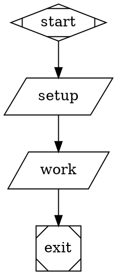

# Replace preparation settings with command nodes

`run.prepare` is no longer supported in workflow, project, or host settings.
Its presence is an error even when empty or overridden. Invalid TOML also
fails admission without printing source values.

Remove the preparation section:

```toml
[run.prepare]
steps = [{ script = "make setup" }]
```

Place the command after `start`, before the work that needs it:



- Preserve step order. Move every former outgoing start edge to the last
  setup node, retaining its conditions and other attributes.
- Set each node's old timeout (default `5m`) and `on_failure="exit"`.
  Ordinary commands otherwise default to ten minutes and routing failures.
  Existing graph retry defaults still apply.
- Convert argv arrays with proper shell quoting; for complex commands,
  invoke a checked-in script.
- Use command-local assignments for literal environment values, such as
  `MODE=setup ./setup.sh`. Secrets can use the existing workflow environment,
  for example `[run.environment.env]` with `TOKEN = "{{ secrets.TOKEN }}"`.
  This makes them available to other workflow processes too; late resolution
  and output masking remain in place.
- Setup commands receive ordinary hooks. Review broad matchers that assume
  dependencies are already installed. The `run_prepare_` name prefix no
  longer suppresses hooks, including on commands in saved runs.

Rust callers must remove uses of `RunSettings.prepare`,
`RunSettings.prepare_timeout_ms`, `PrepareStep`, and `PREPARE_NODE_PREFIX`.
Stored command graphs and the general command environment support are unchanged.
