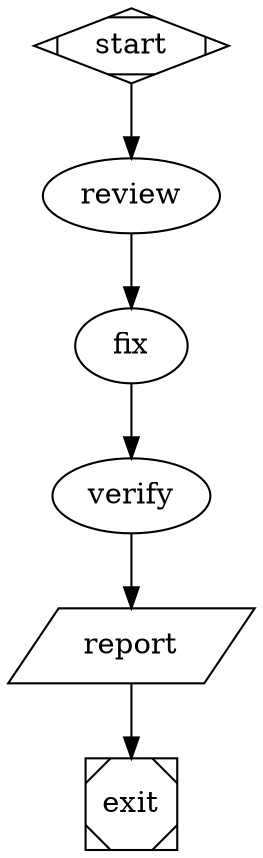

# Agent permissions

Petri exposes Pebble's tool permission levels for native agent stages. A workflow
can mix reviewers that only read files with editors and agents that run commands.
This is a Petri extension to the Attractor and Fabro formats.



The levels use the exact spellings `read-only`, `read-write`, and `full`:

| Level | Agent tools permitted |
| --- | --- |
| `read-only` | Pebble's native read/search tools and subagent tools |
| `read-write` | The above, plus native file writes, edits, and patches |
| `full` | All tools, including arbitrary shell commands, web tools, MCP tools, and host tools |

Permissions are enforced by Pebble's permission middleware at tool discovery and
execution. Petri installs no approval service that can raise these levels. Tool
identity, rather than a display name or a workflow hook's decision, determines
which level is required. Extensions and MCP tools require `full`, even when they
advertise a read-like name. A host must trust the implementations of tools it
registers, including their canonical identities.

Neither `read-only` nor `read-write` permits arbitrary shell commands. In
particular, an agent cannot run `git log`, `git show`, or a test command at those
levels. Prepare Git history or other command output in deterministic workflow
steps and pass it to the agent, or explicitly grant the stage `full`.

## Defaults and stage selection

A node's `permissions` overrides the graph's `default_permissions`. Fabro settings
can supply a lower-priority default:

```toml
[run.agent]
permissions = "read-only"
```

The order is node, graph, then run settings. With all three omitted, agents retain
Petri's historical `full` access. Unknown values and wrong types are errors.
`RunSettings.permissions` exposes the run default to frontends embedded in Rust.
The native `attractor/agent` step configuration accepts the same `permissions`
string, deserialized as `AgentConfig.permissions`. A node's selection also applies
to local agent hooks attached to that stage; run-level agent hooks use the workflow
default. Deterministic scripts, command hooks, prompt-only model calls, and
Petri's log/blob/report persistence are separate from agent tool execution.

ACP agents are external processes whose tools Petri cannot reliably police.
A restricted ACP stage is rejected, including when the restriction comes from a
host ceiling. `full` preserves existing ACP behavior and its permission hooks.

## Embedding host ceiling

The host can register a ceiling as a runtime capability:

```rust
use petri::attractor::{AgentPermissionCeiling, AgentPermissions};

let runtime = petri::runtime()
    .capability(AgentPermissionCeiling(AgentPermissions::ReadOnly));
```

Use the same capability on the runtime used to resume a run. The effective level
is the more restrictive of the stage's requested level and the host ceiling.
The ceiling is host configuration, not a workflow field, and is applied when each
session opens. This includes sessions rebuilt from retained conversations and
new sessions after process restart. An earlier stage's full-access conversation
cannot authorize tools in a later read-only stage. Subagents inherit their
parent's effective permission middleware and cannot raise it.

The capability covers Petri's native agent backend and its installed local agent
hook service. Hosts replacing the hook service or providing custom step backends
must enforce their own policy. It does not restrict workflow scripts or isolate
untrusted workflows from the host; use an appropriate execution environment for
that boundary.
